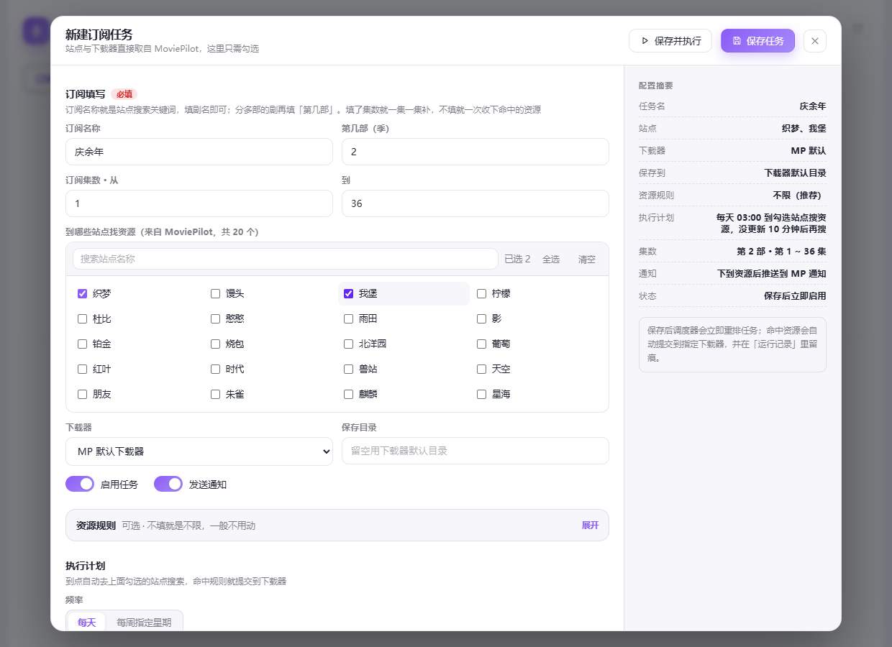
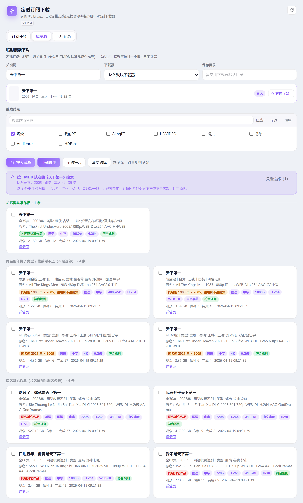

# 定时订阅下载（PtSubscriber）

MoviePilot v3 插件：按你设定的「每周几 / 几点」，自动到指定 PT 站点搜索剧集资源，命中规则后提交到下载器；一集一集补，下过的不会重复下载，没更新会自动重试。

站点与下载器**全部实时读取 MoviePilot 自身的配置**，换机器安装即用，不需要额外填账号。






## 功能

- **聊天里直接订阅（不用打斜杠）**：在 QQ / 微信 / Telegram 里直接说「订阅 天才女友」，插件会抢在 MP 原生订阅链之前接管。先列 TMDB 同名候选（年份、剧集/电影、集数、一句简介），回「1」后依次定「从第几集 / 只下哪几集 / 用哪些站 / 多久刷一次」，回「确定」立刻补搜——订阅只落本插件的表，跟 MP 自带订阅无关。
- **不订阅直接下**：说「找资源 仙逆」或发 `/ptfind 仙逆`，只搜一轮资源、按做种数排序列出来，回 `1` 或 `1-3` 直接下发下载器，不建订阅；回「订阅」可以改成追更
- **海报墙**：订阅列表按海报墙展示（顶部通栏大图 + w500 高清），自动对接 TMDB 识别年份、季数与总集数，卡片上直接看「已下 / 总数」与最近执行时间
- **同名作品可选**：填名字时实时列出 TMDB 候选，标注「动画 / 真人」、年份与总集数（《凡人修仙传》2020 动画 210 集、2025 真人 30 集一眼分得开）；选中后列表自动收起成一行，点这一行或「更换」可重新展开切换，不占版面
- **候选默认选对**：候选按「片名与输入是否完全同名」排序，输入《天下第一》时 2005 正剧排第一，《天下第一良配》这类同名短剧自动靠后，不用每次手动挑
- **定时补搜**：每天 / 每周指定星期 + 时间点触发；不用守着首播
- **一集一集补**：填了集数区间就只补「下一个还没下到的集」，下到就记账，下次看下一集
- **未更新自动重试**：搜不到时按「每隔 N 分钟」再搜，守候时长到点收工（两个参数都可配）
- **下载去重**：按种子 key 记账，同一资源不会重复提交
- **资源规则**：分辨率 / 编码 / 来源 / 字幕 / 促销 / HDR / 体积区间 / 做种数，留空即不限
- **临时搜索**：「找资源」页可直接按关键词搜指定站点，挑中即提交下载器；关键词同样先过 TMDB 认作品，同名动漫/真人点一下就能分清
- **搜完能对得上**：不是只比片名，而是拿 TMDB 认准的那部（片名是否独立、年份、剧集/电影、集数、动画/真人）逐项比资源标题——《天下第一》会跟 1983 电影、2021 短片、《别装了，你就是天下第一》混在一起，现在每条都写明「同名但 1983 年 ≠ 2005，是电影不是剧集」或「同名其它作品」；顶部直接告诉你这一堆里有几条真对得上，还能一键「只看这部」，不用在一屏同名剧里翻找
- **运行记录**：每轮的目标集数、命中站点、分辨率、提交结果全部留痕
- **通知**：走 MoviePilot 自带通知链路（QQ / 微信 / Telegram 等），下到资源后推送
- **界面自适应**：深浅色跟随 MoviePilot 主题

## 远程订阅（智能助手 / QQ）

不想开网页也能加订阅，两条路都直接落到本插件的订阅表，**不走 MoviePilot 自带订阅**。

QQ / 微信 / Telegram 里**不用打斜杠**，直接说人话就行——插件会抢在 MP 原生「搜片 → 回 1」之前接管：

```
你：订阅 天才女友
它：「天才女友」找到 4 个同名作品，回序号选：
    1. 天才，女友（2026 · 剧集 · 28集）
       两个天才少女互相扶持的成长故事……
    2. 我的天才女友（2018 · 剧集 · 30集）
    ……

你：1
它：已选：天才，女友（2026 · 剧集 · 28集）
    当前：从第1集起 · 全部 61 个可搜站 · 每天 03:00
    要改就回一句：集数「从5集」「5-8集」／站点「站点馒头」／刷新「每天3:00」「每30分钟」／「立即」

你：从5集
它：已记下：…… 当前：从第5集起 · 全部 61 个可搜站 · 每天 03:00
    回「确定」开始；还能接着改集数 / 站点 / 刷新时间。

你：确定
它：已订阅：天才，女友（2026 · 剧集 · 从第5集起）……
    已在后台立即搜一轮，结果会按订阅通知再发你。
```

只找资源、不订阅：

```
你：找资源 仙逆
它：「仙逆」找到 8 条资源，回序号直接下：
    1. [馒头 · 2160p · 第120集 · 1.8G · 32种 · 免费] Xian.Ni.EP120…
    ……
    回「1」下第 1 条；多条回「1-3」或「1,3」；回「订阅」改成定时追更。

你：1-2
它：已提交 2 条到「qb」……
```

### 命令一览

| 命令 / 说法 | 作用 |
| --- | --- |
| `订阅 片名` 或 `/ptsub 片名` | 查同名作品，回序号后选集数/站点/刷新时间 |
| `找资源 片名` 或 `/ptfind 片名` | **只找资源直接下发下载器，不订阅** |
| 回 `1` / `1-3` / `1,3` | 选序号（`/ptfind` 支持一次选多条） |
| 回 `从5集` / `5-8集` | 只从第 5 集开始补 / 只下第 5–8 集 |
| 回 `站点馒头,岛` | 只在指定站点搜（写站点中文名就行，不用记域名） |
| 回 `每天3:00` / `每周三21:30` / `每30分钟` | 改刷新计划 |
| 回 `立即` | 建完立刻搜一轮（后台跑，先回执再搜） |
| 回 `确定` | 按当前设置建订阅并立刻补搜 |
| 回 `订阅`（找资源后） | 把刚才搜到的作品改成追更订阅 |
| `/ptlist` | 我的订阅与进度（下到第几集） |
| `/ptsub 站点` | 列出可搜索站点（站点名打错时也会给这个清单） |

参数可以一次带全，顺序随意：`/ptsub 天下第一 从5集 站点馒头,岛 每天3:00 立即`；
也支持 `集=5 站=馒头 时=03:00` 这种写法；`1 从5集 站点馒头` 这种「序号+参数」一条也能建。

### 为什么不会跑到 MP 原生订阅

宿主处理一条聊天消息的顺序是：`/命令` → AI 前缀 → 活跃会话（例如 MP 原生「搜片 → 回 1」）→ AI 智能体 → `MediaInteractionChain`（「订阅 XXX」原生订阅）。

「订阅 天才女友」「1」正好落在第 3 / 5 步，以前会被 MP 原生订阅吃掉（于是订阅跑到 MP 订阅页、回复带海报图）。
本插件在这两层做了**前置接管**：认出「订阅 / 找资源 / 序号 / 集数 / 站点 / 刷新时间」就自己处理，认不出就原样交回宿主，行为与没装插件时一致；插件停用会自动还原。

### 为什么快

远程回复全程纯文本，不带海报图片、不带链接；TMDB 只做一次搜索、不逐个拉详情（约 1.5 秒出候选），
点选确认时才补年份/集数/海报这类细节。

> 前提：该渠道要能收到消息（在 MP「设定 → 通知」里配好并启用交互），先在插件页的「测试通知」确认能收到，再试命令。
> 候选 / 资源列表有效期 30 分钟，超时重新发一次片名即可。

## 安装

### 方式一：插件市场添加仓库（推荐，可跟随更新）

1. MoviePilot → 插件市场 → 右侧筛选面板 → 仓库 → 填本仓库地址：
   `https://github.com/wzy631678/MoviePilot-Plugins`
2. 刷新插件市场，搜索「定时订阅下载」，点击安装
3. 安装后到「我的插件」打开，即可使用

> ⚠️ 仓库地址必须是标准 GitHub 地址，**不要**在前面加 `gh-proxy.com/` 之类的加速前缀。
> MoviePilot 需要从地址里解析 `用户/仓库名`，加了前缀会解析成 `github.com/wzy631678`，索引直接 404。
> 国内无法直连时，请改在「设置 → 系统 → GitHub 代理」填加速地址，或给 MoviePilot 配置 HTTP 代理。

> 说明：已经安装的插件不会在市场里重复出现（市场只列未安装、或有新版本的插件），
> 这是 MoviePilot 的既定逻辑，不是没发布成功。卸载后会重新出现在市场列表。

### 方式二：本地安装

1. 下载本仓库 Release 中的 `ptsubscriber_v*.zip`，或把 `plugins.v3/ptsubscriber/` 目录压成 zip（zip 根目录直接是 `__init__.py`、`dist/`，不要多套一层文件夹）
2. MoviePilot → 插件 → 本地安装，上传该 zip
3. 若安装后没出现在列表里，重启一次 MoviePilot 容器即可

### 仓库结构（给其他插件作者参考）

```
package.v3.json              # v3 市场索引（MoviePilot v3 首选读这个）
package.json                 # v1 索引兜底，条目需声明 "v3": true
icon.png                     # 插件图标
plugins.v3/ptsubscriber/     # 插件源码（目录名为插件 ID 小写）
```

发布 Release 时：tag 必须是 `PtSubscriber_v{版本号}`，资产名必须是 `ptsubscriber_v{版本号}.zip`，
zip 内直接是插件文件；索引条目声明 `"release": true` 后，MoviePilot 会优先用 Release 包安装。

## 使用

1. 打开插件页 → 「创建第一个任务」
2. 填写：订阅名称（同时作为站点搜索关键词）→ 第几部（可选）→ 集数从…到…
3. 勾选要搜索的站点（默认全不选，按需勾）
4. 资源规则默认「不限」，需要 1080p / 中文字幕 / 免费种等再展开设置
5. 执行计划：每天或每周指定星期 + 时间；未更新重试间隔与守候时长
6. 「保存并执行」可当场先补一集，之后按计划自动跑

## 依赖

- MoviePilot v3.2.x（`_PluginBase` 动态插件 + Vue 联邦前端）
- 已在 MoviePilot 中配置好站点与下载器（插件不自带站点账号）

## 说明

- 插件不收集、不上传任何数据；所有订阅与记录只保存在 MoviePilot 的插件数据目录里
- 通知内容与渠道由 MoviePilot 的「设置 → 通知」决定
- 仅供个人自用，请遵守各 PT 站点规则

## License

MIT
